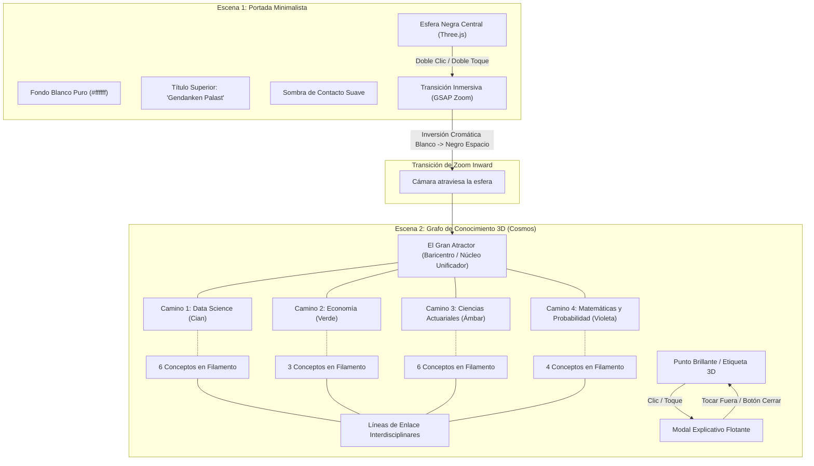

# Bitácora Histórica y Registro Integral de Acciones e Intenciones
## Proyecto: Gedankenpalast — Singularidad Cognitiva & Grafo Cosmológico 3D

> **Documento de síntesis cronológica**: Registro exhaustivo día a día de las necesidades expresadas, decisiones arquitectónicas, exploraciones técnicas y logros implementados a lo largo de la colaboración.

---

### Tabla de Contenidos
1. [Visión General del Proyecto](#visión-general-del-proyecto)
2. [Día 1 — 5 de Octubre de 2026: Entorno de Desarrollo, Control de Versiones y Diagnóstico de IDEs](#día-1--5-de-octubre-de-2026)
3. [Día 2 — 7 de Octubre de 2026: Homogeneización de Herramientas y Nacimiento del Concepto Gedankenpalast 3D](#día-2--7-de-octubre-de-2026)
4. [Día 3 — 20 de Octubre de 2026: Maduración Teórica: Analogía Astrofísica de Laniakea y Mapeo Actuarial](#día-3--20-de-octubre-de-2026)
5. [Día 4 — 25 de Octubre de 2026: Síntesis Minimalista Pura, Arquitectura Dual Three.js y Optimización Multiplataforma](#día-4--25-de-octubre-de-2026)
6. [Resumen de Arquitectura Técnica y Estado Final del Sistema](#resumen-de-arquitectura-técnica-y-estado-final-del-sistema)

---

### Visión General del Proyecto

**Gedankenpalast** ("Palacio de los Pensamientos" en alemán) surge como una materialización tridimensional e interactiva del conocimiento actuarial, matemático, económico y de ciencia de datos. Su propósito es trascender la organización estática tradicional (carpetas, índices o documentos lineales) para representar las disciplinas como una **topología cósmica continua**.

El proyecto evolucionó desde una necesidad de estructuración de repositorios académicos hacia una aplicación web monocanvas en **Three.js** con dos estados contrastantes:
- **Escena 1 (Portada)**: Una estética minimalista y limpia con fondo blanco puro y una bola negra central sobre la que se interactúa con ratón o tacto.
- **Escena 2 (Cosmos / Grafo 3D)**: Un supercúmulo cósmico en el que 4 grandes caminos o filamentos convergen hacia un centro unificador común: **"El Gran Atractor"**.

---

### Día 1 — 5 de Octubre de 2026
#### Entorno de Desarrollo, Control de Versiones y Diagnóstico de IDEs

#### 1. Contexto e Intención del Usuario
El usuario inició la jornada con la meta de asentar su infraestructura técnica local, estructurar sus asignaturas y proyectos actuariales en carpetas organizadas, solucionar conflictos en su editor VS Code con lenguajes cuantitativos (R, STATA, SAS, SQL, Matlab) y comprender con claridad el flujo de trabajo con Git, GitHub y extensiones avanzadas de trazabilidad como GitLens.

#### 2. Acciones Realizadas y Decisiones Técnicas
- **Instalación y Clonación de Repositorios**:
  - Lectura e implementación de las directrices del repositorio `Kuerb0/Arbol_de_la_estadistica` (`README_INSTALACION.md`).
  - Configuración inicial de dependencias de visualización estadística.
- **Organización Estructural de Carpetas**:
  - Limpieza, estandarización y ordenamiento sistemático del directorio de trabajo actuarial (`c:\Users\luzur\.antigravity-ide\Actuariales`) y la carpeta `Asignaturas`.
  - Reubicación y estructuración de cuadernos de notas, scripts y recursos por áreas temáticas.
- **Diagnóstico y Reparación de Errores en VS Code**:
  - Resolución del bloqueo de la terminal al abrir VS Code asociado a comandos residuales de Node.js en PowerShell.
  - Corrección de rutas y configuraciones de plugins para `SQLTools`, extensiones de `R`, `STATA` y `SAS`.
  - Análisis de la conectividad de `Matlab`: diagnóstico de la variable de entorno `PATH`, instalación del motor para integración externa (`Matlab Engine for Python`) y configuración de la extensión oficial de MathWorks.
- **Formación Conceptual en Ecosistema Git**:
  - Clarificación didáctica y operativa de la jerarquía de versionado:
    - **Git**: El motor criptográfico distribuido que gestiona snapshots locales en el árbol de commits.
    - **GitHub**: La plataforma remota en la nube para sincronización colaborativa y repositorios remotos.
    - **GitHub Desktop**: La interfaz gráfica de usuario (GUI) para interactuar con Git de forma visual.
    - **GitLens**: La herramienta de telemetría y auditoría en línea dentro de VS Code que proyecta la autoría (`git blame`), historial de cambios y calor de edición línea a línea.
- **Activación de GitLens**: Verificación e integración exitosa de GitLens dentro del entorno de desarrollo.

---

### Día 2 — 7 de Octubre de 2026
#### Homogeneización de Herramientas y Nacimiento del Concepto Gedankenpalast 3D

#### 1. Contexto e Intención del Usuario
Con el editor principal ya estabilizado, el usuario solicitó sincronizar las mismas conexiones y capacidades en su entorno **Antigravity IDE**, y seguidamente reactivó el desarrollo creativo de su proyecto central: **Gedankenpalast**. En este punto, compartió referencias visuales de Sketchfab para definir la primera visión tridimensional.

#### 2. Acciones Realizadas y Decisiones Técnicas
- **Sincronización de IDEs**:
  - Inspección de perfiles de extensiones y validación de que Antigravity IDE compartiera las integraciones de GitLens y entornos de ejecución.
- **Reactivación del Repositorio `Gedankenpalast`**:
  - Acceso y auditoría del directorio local `C:\Github\Gedankenpalast` y su remoto en GitHub (`LuizLuzuriaga/Gedankenpalast`).
- **Análisis de Modelos y Referencias 3D (Sketchfab)**:
  - *Referencia 1*: Esfera minimalista VFX sobre fondo de alto contraste (*Sphere by DjSheri*).
  - *Referencia 2*: Estructura fractal y nubes de dispersión matemática (*Repellers in reconstruction from CF4 groups*).
  - *Referencia 3*: Filamentos cósmicos y telaraña de galaxias (*The Cosmic V-Web by Daniel Pomarède*).
- **Prototipo 3D Inicial (Three.js)**:
  - Creación de los primeros archivos `index.html`, `style.css` y `main.js`.
  - Implementación de un modelo de partículas en Three.js con animación orbital básica y una transición de aproximación mediante cámara virtual.

---

### Día 3 — 20 de Octubre de 2026
#### Maduración Teórica: Analogía Astrofísica de Laniakea y Mapeo Actuarial

#### 1. Contexto e Intención del Usuario
El usuario planteó una evolución conceptual de enorme valor teórico: en lugar de un mapa de nodos abstracto o una nube arbitraria de puntos, el sistema debía estructurarse bajo la **analogía topológica del supercúmulo Laniakea**. En astrofísica, las galaxias no se confinan por fronteras arbitrarias, sino por líneas de flujo gravitacional que convergen hacia una cuenca común: **El Gran Atractor**.

#### 2. Acciones Realizadas y Decisiones Técnicas
- **Formulación del Modelo Teórico "Laniakea del Conocimiento"**:
  - **El Gran Atractor**: El núcleo unificador donde converge todo el valor aplicado: *Evaluación y Mitigación del Riesgo Financiero y Vital* (cálculo de solvencia, suficiencia de capital bajo Solvencia II / IFRS 17, pricing dinámico, teoría de la ruina).
  - **Brazos y Filamentos de Flujo**:
    - *Brazo Actuarial*: Modelos de vida y no vida, tablas de mortalidad dinámicas, IBNR (Chain Ladder).
    - *Brazo Data Science / ML*: Algoritmos predictivos, aprendizaje profundo y minería de datos.
    - *Brazo Económico-Financiero*: Modelos macroeconómicos, microeconomía y equilibrio estocástico.
    - *Brazo Matemático-Probabilístico*: Cálculo estocástico, optimización convexa y álgebra matricial como base de sustentación de los demás brazos.
  - **Nodos Metodológicos**: Integración de conceptos de alta densidad técnica (Cópulas, Cadenas de Markov, Series temporales, GLMs).
- **Inversión Estética y Distorsión Espacio-Tiempo**:
  - El usuario especificó una contraposición cromática:
    - Portada: Fondo blanco inmaculado con esfera negra solitaria en el centro.
    - Transición: Efecto de zoom y distorsión espacio-tiempo que atraviesa el horizonte de la esfera negra.
    - Interior: Fondo cósmico oscuro con puntos brillantes de alta intensidad lumínica.
- **Investigación e Integración de Assets 3D**:
  - Descarga y desempaquetado de modelos GLTF/GLB complejos dentro del proyecto (`alien_space_nebula` y `need_some_space`).
  - Pruebas de integración con `GLTFLoader` de Three.js para evaluar la viabilidad de embeber entornos espaciales densos en la web.

---

### Día 4 — 25 de Octubre de 2026
#### Síntesis Minimalista Pura, Arquitectura Dual Three.js y Optimización Multiplataforma

#### 1. Contexto e Intención del Usuario
Durante esta jornada, el usuario refinó con máxima exactitud sus requerimientos finales, eliminando todo el ruido visual, modelos pesados y elementos accesorios para centrarse en una experiencia **pura, minimalista y ultra-rápida**, con total soporte para escritorio y dispositivos móviles.

Las instrucciones definitivas exigieron:
1. **Escena 1 (Portada)**: Fondo blanco limpio; arriba centrado **únicamente** `"Gendanken Palast"` sin ningún otro texto instructivo; en el centro una bola negra explorable con ratón/dedo; entrada por doble clic o doble toque hacia la Escena 2 mediante transición de zoom.
2. **Escena 2 (Grafo de Conocimiento en 3D)**: Fondo oscuro espacial pre-renderizado; supercúmulo con filamentos/caminos convergiendo hacia "El Gran Atractor"; puntos brillantes exclusivos para conceptos (sin estrellas ni luces decorativas extra); 4 caminos definidos con sus conceptos y conexiones interdisciplinares; navegación completa (arrastre y pellizco/zoom); panel modal informativo al tocar un concepto, cerrable al pulsar fuera.
3. **Multiplataforma**: Compatibilidad total táctil y de escritorio.

#### 2. Acciones Realizadas y Soluciones Técnicas

##### A. Reestructuración de la Portada (Escena 1)
- **Eliminación Total de Ruido Visual**: Se retiraron subtítulos, badges, tutoriales ("haz doble clic") o barras de búsqueda de la portada. El encabezado quedó restringido de forma estricta a:
  ```html
  <header id="portada-header">
      <h1 class="palast-title">Gendanken Palast</h1>
  </header>
  ```
- **Esfera Negra y Sombra de Contacto**:
  - Geometría de alta resolución (`SphereGeometry(140, 64, 64)`) con material mate oscuro `#05070c`.
  - Sombra de contacto inferior difuminada (`RingGeometry`) sobre el fondo blanco para aportar presencia física y gravedad visual.
- **Interacción de Entrada Dual**:
  - **Escritorio**: Evento `dblclick` con raycasting hacia la esfera negra.
  - **Móvil**: Algoritmo propio de detección de doble toque (`touchstart` + `touchend`) con umbral de 420 ms y tolerancia de desplazamiento (< 45 px).

##### B. Transición Inmersiva (GSAP)
- Animación de cámara coordinada:
  - Empuje de cámara hacia el centro de la esfera negra (`camera.position.z` de 320 a 15 con curvatura `power2.in`).
  - Difuminado del encabezado y desvanecimiento de la esfera y sombra de contacto (`opacity: 0`).
  - Interpolación del color de fondo (`scene.background` y `renderer.setClearColor`) de blanco puro `#ffffff` al negro espacial `#03050b`.
  - Activación inmediata de la Escena 2 y revelación de la cámara panorámica cosmológica (`camera.position` a `[180, 130, 580]`).

##### C. Grafo Cosmológico 3D (Escena 2)
- **El Gran Atractor**: Ubicado en el baricentro `(0, 0, 0)`, representado por un orbe blanco-dorado de resplandor intenso con un anillo de energía concéntrico (`RingGeometry`).
- **Los 4 Caminos / Filamentos Tubulares**:
  1. **Data Science** (Cian `#38bdf8`): Estadística, Econometría (Modelos Econométricos), Machine Learning supervisado, Machine Learning no supervisado, Deep Learning, Data Mining.
  2. **Economía** (Verde Esmeralda `#34d399`): Macroeconomía, Microeconomía, Econometría (conectada directamente con Data Science).
  3. **Ciencias Actuariales** (Ámbar Dorado `#fbbf24`): Seguros de Vida, Seguros No Vida, Gestión de riesgos, Solvencia II, IFRS 17, Contabilidad (conectada con IFRS 17).
  4. **Matemáticas y Probabilidad** (Violeta `#c084fc`): Probabilidad, Álgebra lineal, Cálculo, Optimización (conectada con Estadística, ML y Actuariales).
- **Estructura de Filamentos**: Curvas cúbicas 3D (`CatmullRomCurve3` y filamentos trenzados) que forman los "tubos" cósmicos donde se agrupan los nodos temáticos.
- **Conexiones Interdisciplinares**: Modeladas con líneas finas y tenues (`LineBasicMaterial({ color: 0x94a3b8, transparent: true, opacity: 0.35 })`) uniendo los conceptos solicitados:
  - `Econometría (Eco)` $\longleftrightarrow$ `Econometría (DS)`.
  - `Contabilidad` $\longleftrightarrow$ `IFRS 17`.
  - `Probabilidad` $\longleftrightarrow$ `Estadística`, `Seguros de Vida` y `Gestión de riesgos`.
  - `Álgebra lineal` $\longleftrightarrow$ `ML supervisado` y `ML no supervisado`.
  - `Cálculo` $\longleftrightarrow$ `Optimización` y `Deep Learning`.
  - `Optimización` $\longleftrightarrow$ `ML supervisado` y `Microeconomía`.
- **Exclusión de Elementos Parásitos**: Se eliminaron completamente las estrellas de fondo aleatorias, nubes de polvo y luces auxiliares para cumplir la regla estricta: *"Solo hay puntos brillantes: cada punto es un concepto de conocimiento"*.

##### D. Interacción y Panel Modal Informativo
- **Hitboxes Ampliados para Raycasting**: Cada punto dispone de un área de impacto invisible (`SphereGeometry` con `opacity: 0, depthWrite: false`) de radio $\ge 20$, garantizando que tanto el clic del ratón como el toque dactilar en pantallas táctiles seleccionen el concepto sin frustración.
- **Etiquetas 3D Proyectadas**: Etiquetas HTML flotantes en tiempo real con efecto *glassmorphism*, que también responden a clic y toque directo.
- **Panel Informativo Flotante**:
  - Muestra categoría, color distintivo, título del concepto, descripción técnica rigurosa e insignias interactivas de las conexiones salientes.
  - Cierre instantáneo al hacer clic en el botón de cierre, al pulsar fuera de la tarjeta en el fondo modal (`pointerdown`), o al tocar cualquier punto exterior en pantalla.

##### E. Despliegue, Validación y Calidad
- Servidor de previsualización local ejecutado en el puerto 8099 (`http://localhost:8099/?v=5.0`).
- Validación exhaustiva mediante subagente de navegación automatizada, verificando la carga limpia de la portada, la transición de zoom inmersiva, el despliegue del grafo cosmológico y la apertura/cierre de paneles.

---

### Resumen de Arquitectura Técnica y Estado Final del Sistema



#### Ficheros del Repositorio (`C:\Github\Gedankenpalast`):
| Archivo | Responsabilidad Principal |
| :--- | :--- |
| **`index.html`** | Estructura semántica limpia, canvas WebGL, etiquetas proyectadas y contenedor del modal explicativo. |
| **`style.css`** | Sistema de diseño minimalista, tipografía *Outfit* y *Space Grotesk*, efectos de *glassmorphism* y adaptabilidad móvil. |
| **`main.js`** | Lógica completa de Three.js: doble escena, sistema de partículas conceptuales, filamentos tubulares, OrbitControls amortiguado, hitboxes ampliadas y gestión de gestos táctiles. |
| **`BITACORA_HISTORICA_GEDANKENPALAST.md`** | Memoria histórica y registro técnico completo del proyecto. |
